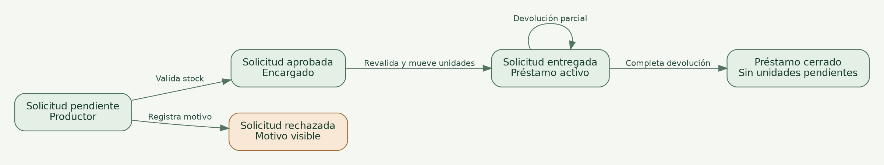

# AgroRetorno | Especificación de requisitos de software

| Control | Dato |
|---|---|
| Identificador | AR-ERS |
| Versión documental | 1.1.0 |
| Fuente de alcance | Primer avance, §§1–4, pp. 2–8 |
| Línea base del código cotejado | Git `a28b7e46875d362b5074cff7149343457a4e01a6` |
| Estado | Cotejada con el primer avance. Validación por usuarios representados y aprobación docente pendientes de registro. |
| Responsable asignado | Ower López Arela, G01/G02/G05 |
| Referencia de estructura | IEEE 830-1998 |

## 1. Introducción

### 1.1 Propósito y problema

Las cooperativas agrícolas de Arequipa almacenan y prestan materiales reutilizables. Con registros manuales se pierde visibilidad sobre unidades disponibles y prestadas, se pueden autorizar entregas sin existencias y quedan devoluciones sin clasificación ni responsable. AgroRetorno registra estas operaciones, controla saldos y permite identificar préstamos vencidos.

### 1.2 Alcance

Incluye acceso por rol, gestión de productores, catálogo de cinco categorías, existencias, solicitudes, decisión del almacén, entrega, devolución parcial o total, historial y reporte. Quedan fuera los pagos, ventas, geolocalización, aplicación móvil nativa, predicción y servicios externos de negocio.

| Rol o interesado | Necesidad |
|---|---|
| Productor | Buscar material disponible, solicitar cantidades y consultar el estado de sus registros. |
| Encargado | Administrar productores y materiales, validar existencias, resolver solicitudes y registrar entregas y devoluciones. |
| Cooperativa representada | Conciliar existencias y conocer el destino y condición de sus unidades. |
| Desarrollo, operaciones y calidad | Reproducir compilación, gestionar la base de datos y verificar controles y métricas. |
| Docente | Validar alcance y comprobar que las evidencias corresponden a cada guía. |

El caso y los datos son ficticios. La entrevista y el cuestionario se aplicarán a personas que representen los roles, documentando quién ejerció cada rol.

## 2. Descripción general

- Interfaz web Thymeleaf/Bootstrap para ambos roles. Rutas `/productor/**`, `/encargado/**` y acceso por formulario con protección CSRF.
- API REST JSON bajo `/api/**`, con autenticación HTTP Basic y autorización de servidor.
- Monolito Spring Boot sobre Java 21. PostgreSQL es la persistencia operativa y Flyway versiona el esquema. La integración Maven usa H2 aislado.
- El encargado registra el acto físico. Se usa la zona horaria America/Lima y las cantidades son unidades enteras.
- Solicitud y aprobación verifican disponibilidad. La aprobación no reserva unidades. La entrega vuelve a comprobar stock, registra un préstamo único y deja la solicitud como `ENTREGADA`.
- Una devolución parcial conserva el préstamo `ACTIVO`. Una devolución completa lo deja `CERRADO`. `VENCIDO` es una condición de presentación de un préstamo activo con fecha pasada.

## 3. Requisitos funcionales

La columna Fuente remite al requisito con el mismo ID del primer avance, §3.4. Las precisiones de reglas proceden de §3.2–3.3. Alta y Media conservan la prioridad original. La matriz registra el caso de verificación y su alcance.

| ID | Requisito | Fuente | Prioridad | Interesado | Aceptación observable |
|---|---|---|---|---|---|
| RF01 | Autenticar y cerrar sesión de usuarios registrados. | §3.4 RF01 | Alta | Ambos roles | Credencial válida abre el panel del rol. Una inválida no crea sesión y muestra un mensaje. Tras salir, una ruta protegida exige autenticación. |
| RF02 | Aplicar permisos por rol en el servidor. | §3.4 RF02 | Alta | Ambos roles | El usuario autenticado ve sus opciones. Una petición directa a una ruta exclusiva del otro rol obtiene 403. |
| RF03 | Registrar, actualizar, activar e inactivar productores. | §3.4 RF03 | Media | Encargado | Un DNI de ocho dígitos y único se acepta. DNI repetido o de formato inválido se rechaza. El cambio de estado se refleja en las consultas. |
| RF04 | Registrar y administrar materiales. | §3.4 RF04 | Media | Encargado | Se guarda un código único con una de cinco categorías válidas. Se rechaza el código repetido y es posible activar e inactivar el material. |
| RF05 | Administrar existencias y guardar sus movimientos. | §3.4 RF05 | Alta | Encargado | Ingreso, retiro, mantenimiento y baja actualizan el saldo y dejan un movimiento. El total cuadra con disponible, prestado, dañado y mantenimiento. Un ajuste inválido conserva el saldo. |
| RF06 | Consultar disponibilidad de materiales activos. | §3.4 RF06 | Alta | Productor | Se muestra el saldo disponible de materiales activos. Búsqueda por texto y categoría permite encontrar el material esperado. Un material inactivo queda fuera. |
| RF07 | Registrar solicitudes de préstamo. | §3.4 RF07 y §3.3 | Alta | Productor | Una solicitud válida para material activo queda PENDIENTE sin reservar stock. Cantidad no positiva o superior al saldo, fecha fuera de 1–90 días o motivo inválido generan error sin alta. |
| RF08 | Consultar el seguimiento de solicitudes propias. | §3.4 RF08 | Media | Productor | El productor ve estado y motivo de rechazo de sus solicitudes. Consultar directamente una solicitud ajena obtiene 403. |
| RF09 | Aprobar solicitudes pendientes con stock suficiente. | §3.4 RF09 | Alta | Encargado | La solicitud pasa a APROBADA con actor y fecha sin descontar existencias. Si falta stock se rechaza y conserva el estado. |
| RF10 | Rechazar solicitudes con motivo. | §3.4 RF10 | Alta | Encargado y productor | Un rechazo válido deja estado RECHAZADA y motivo visible al productor. Sin motivo se rechaza la operación. |
| RF11 | Registrar la entrega física. | §3.4 RF11 y §3.2 | Alta | Encargado | Una solicitud APROBADA con stock genera un único préstamo, mueve las unidades a prestado y queda ENTREGADA. Sin stock o ante duplicado se conserva el estado anterior. |
| RF12 | Consultar préstamos y unidades pendientes. | §3.4 RF12 | Media | Ambos roles | Se listan préstamos activos y cerrados con saldo y fecha prevista. Los activos atrasados se identifican como VENCIDO. El productor ve los propios. |
| RF13 | Registrar devoluciones parciales y totales por condición. | §3.4 RF13 y §3.3 | Alta | Encargado | El total devuelto no supera lo pendiente. Daño y mantenimiento exigen observación. Con saldo cero se cierra el préstamo. |
| RF14 | Consultar historial de operaciones. | §3.4 RF14 | Media | Ambos roles | Cada evento muestra actor, acción, entidad y fecha. Se verifican los filtros de fechas, actor, entidad y acción y las restricciones del rol. |
| RF15 | Consultar reporte consolidado. | §3.4 RF15 | Media | Encargado | Se consolidan préstamos, devoluciones y pendientes. Los filtros de fecha, productor, material y estado devuelven totales conciliables con las filas. |

## 4. Requisitos no funcionales

El primer avance, §3.5, fija condiciones y umbrales. Las prioridades y los responsables de esta tabla son propuestas de planificación para ratificar con el equipo. La muestra debe quedar identificada en cada ejecución.

| ID | Atributo y requisito | Fuente | Prioridad propuesta | Responsable o interesado | Criterio y evidencia |
|---|---|---|---|---|---|
| RNF01 | Rendimiento con 10 usuarios, rampa de 30 s y 5 min de duración. | §3.5 RNF01 | Alta | Calidad G08 | JMeter A. p95 ≤ 2 s y errores ≤ 1 %. Conservar JMX, JTL, rutas, entorno y agregación. |
| RNF02 | Almacenar contraseñas con BCrypt. | §3.5 RNF02 | Alta | Seguridad | El 100 % de las contraseñas de la población verificable usa BCrypt y ninguna queda en texto plano. SEG-01 comprueba el mecanismo en una muestra aislada. |
| RNF03 | Bloquear acceso por rol o propiedad y proteger formularios con CSRF. | §3.5 RNF03 | Alta | Seguridad | El 100 % de los casos negativos incluidos devuelve 403. Peticiones web mutantes sin token fallan. SEG-03 a SEG-06 y UI-03, con cobertura indicada por caso. |
| RNF04 | Conservar registros tras reiniciar aplicación y base. | §3.5 RNF04 | Alta | Operaciones | Identidades y conteos de las filas preparadas coinciden antes y después del reinicio de ambos procesos PostgreSQL y aplicación. |
| RNF05 | Rechazar entradas inválidas conservando el estado anterior. | §3.5 RNF05 | Alta | Desarrollo y calidad | Por cada caso inválido registrado se muestra un mensaje comprensible y las filas y saldos afectados coinciden antes y después. PU, IT-02, SEG-08, SEG-10 y UI-05. |
| RNF06 | Mantener integridad de existencias y unicidad de préstamos. | §3.5 RNF06 | Alta | Desarrollo y DBA | Cero saldos negativos y cero préstamos duplicados. El 100 % de materiales verificados cuadra. Revisar CHECK y UNIQUE en PostgreSQL y contrastar con pruebas de servicio. |
| RNF07 | Registrar las operaciones auditables. | §3.5 RNF07 | Alta | Encargado y calidad | El 100 % de las operaciones ejecutadas en la muestra tiene un evento con actor, acción y fecha. Conciliar la lista de operaciones con el historial, con IT-03 como apoyo. |
| RNF08 | Completar los tres procesos de negocio en Chrome de escritorio. | §3.5 RNF08 | Media | Calidad G09 | Suite UI-01 a UI-10 en Chrome con su versión exacta registrada. Conservar resultado por caso, navegador y revisión. |
| RNF09 | Alcanzar cobertura de líneas de servicios de al menos 80 %. | §3.5 RNF09 | Media | Calidad G07 | JaCoCo de la revisión sometida a pruebas. Publicar líneas cubiertas y totales del paquete de servicios. Es una meta del proceso de pruebas. |
| RNF10 | Restaurar la base con los mismos registros. | §3.5 RNF10 | Alta | Operaciones | Restaurar PostgreSQL en una instancia separada y comprobar identidades, conteos y relaciones de la muestra. El dump de SVN cubre un elemento de configuración diferente. |

### Aclaración de configuración vinculada a CR-01

El requisito original RNF02 conserva su contenido. La revisión integra un control complementario de arranque: ante la ausencia de `DEMO_DATA`, se omite la carga de cuentas y datos ficticios. El modo demostración requiere optar por él expresamente. La prueba de esta configuración se vincula a RNF02 y RF01 como control complementario. [Diseño y cambio](https://github.com/MauricioZegarra/AgroRetorno/blob/feature/ower-g02-proceso-de-requerimientos/entregables/G02_Proceso_Requerimientos/Cambios.md#cr-01).

## 5. Decisiones y revisiones

| Hallazgo | Resolución o seguimiento | Evidencia |
|---|---|---|
| El enunciado menciona un mínimo de 10 RF y 5 RNF. | El mínimo y el alcance del producto son compatibles. Se mantienen los 15 RF y 10 RNF del primer avance. | Primer avance §7.1. |
| La ERS previa propuso RNF con otros IDs y métricas. | Se recupera íntegra la identificación oficial. Objetivos adicionales como RPO/RTO quedan fuera de la línea base hasta una solicitud aprobada. | Primer avance §3.5, ERS §§3–4. |
| Aprobación frente a entrega. | Se conserva APROBADA sin movimiento de stock. La entrega revalida saldo y asigna ENTREGADA. | §3.2 del informe, `SolicitudService` y `PrestamoService`. |
| Estado VENCIDO. | Se registra como condición calculada del préstamo activo. Verificar su exposición en los listados de cada rol. | `PrestamoResponse` y revisión de vistas. |
| Etiquetas antiguas de casos. | La matriz usa IDs del primer avance y el ID PU/IT/SEG del caso ejecutado. Las anotaciones del código pueden contener una asociación histórica. | [Matriz](https://github.com/MauricioZegarra/AgroRetorno/blob/feature/ower-g02-proceso-de-requerimientos/entregables/G02_Proceso_Requerimientos/trazabilidad/Matriz_Trazabilidad.md). |

| Versión | Cambio |
|---|---|
| 1.0 documental previa | Borrador basado en G03 y código, con RNF propuestos. |
| 1.1.0 | Cotejo con las secciones 3.4 y 3.5 del primer avance y aclaración de configuración CR-01. |
