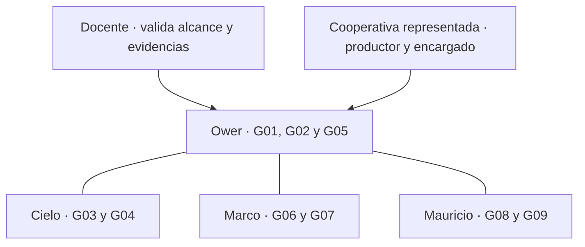

# Plan de trabajo y revisión de la ERS

## Cronograma y responsables

Fechas de hitos tomadas del primer avance, §8. Las actividades intermedias representan planificación.

| Ventana | Actividad | Responsable asignado | Evidencia de salida |
|---|---|---|---|
| 11 nov 2026 | Primer avance, alcance y línea base | Equipo | Informe con 15 RF y 10 RNF |
| 25 nov 2026 | Segundo avance, ERS y configuración en paralelo | Ower | ERS, política SVN, línea base y revisión del producto |
| 25–28 nov 2026 | Elicitación representada, seguimiento y decisión de cambios | Ower y representante | Respuestas registradas y decisiones |
| 26–30 nov 2026 | Repetición de pruebas, inspección de la etiqueta y restauración | Ower y revisión de calidad | Reportes por revisión y dump verificable |
| 2 dic 2026 | Entrega final y sustentación de 20 minutos | Equipo | Paquete integrado y demostración |

## Comparación de gestores

| Opción | Atributos y trazabilidad | Seguimiento | Adecuación |
|---|---|---|---|
| SQLite/Markdown con SVN | Esquema explícito, revisión histórica y enlaces a evidencias. | El estado se registra por evento y se revisa manualmente. | Usado para este bloque. Funciona en local y exporta a CSV. |
| REM | Herramienta especializada, con modelo de requisitos y relaciones. | Su disponibilidad, versión y configuración deben comprobarse en el entorno elegido. | Candidato del primer avance. Queda como alternativa para el bloque. |

## Lista de verificación

| Control | Resultado | Acción pendiente |
|---|---|---|
| Claridad de alcance, roles y restricciones | Revisado contra §§1–3 del primer avance | Confirmar los escenarios con representantes. |
| Identificación única y prioridad | 15 RF y 10 RNF con campos explícitos | Ratificar prioridades de RNF. |
| Consistencia de estados | PENDIENTE, APROBADA, RECHAZADA y ENTREGADA cotejados | Confirmar dónde debe aparecer VENCIDO por rol. |
| Completitud de fuentes y criterios | Tablas ERS cotejadas con §§3.4–3.5 | Incorporar hallazgos de elicitación tras aplicarla. |
| Verificabilidad | Umbrales y condiciones de aceptación documentados | Obtener evidencias pendientes de G08/G09 y PostgreSQL. |
| Trazabilidad | 25 IDs vinculados a componentes y casos | Actualizar los IDs heredados en la suite con los responsables. |
| Aprobación | Pendiente | Registrar persona, fecha, versión y decisión. |
