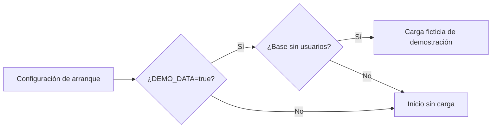

# Solicitudes de cambio de AgroRetorno

## CR-01

| Campo | Registro |
|---|---|
| Asunto | Optar explícitamente por la carga de datos ficticios |
| Origen | Revisión de `application.properties` y `DatosDemoInitializer` en Git `a28b7e4`. El borrador G02 reporta una decisión previa para la copia local. |
| Requisitos | RF01 y RNF02 como control complementario de configuración de cuentas. RNF03 como regresión de autorización y CSRF. |
| Hallazgo | El valor de aplicación y la condición del componente habilitaban el inicializador ante ausencia de configuración. En una base vacía esto permitía sembrar cuentas y registros de demostración. |
| Alcance de decisión | Alcance técnico autorizado para esta rama de práctica. La aprobación nominal y el cierre académico quedan pendientes de registro. |
| Autoría | Implementación técnica preparada por Codex a solicitud de Ower. La asignación de ejecución personal requiere evidencia de Ower. |
| Versión objetivo | Etiqueta SVN de práctica `v1.0.0`. |

### Impacto

| Dimensión | Evaluación |
|---|---|
| Diseño | El arranque se mantiene en Spring Boot. Se requiere un valor verdadero en la propiedad del inicializador. El caso de propiedad ausente se trata como desactivado. |
| Esfuerzo y plazo | Estimación de 1–2 horas de implementación, pruebas y revisión, dentro de medio día de trabajo. |
| Costo | S/ 100–200 como estimación a S/ 100/h. El informe no registra gasto incurrido. |
| Riesgo | Una base vacía sin aprovisionar no tendrá cuentas iniciales. Para demostración aislada, habilitar `DEMO_DATA=true` de forma explícita. Para uso ordinario, aprovisionar una cuenta inicial mediante el procedimiento del responsable de despliegue. |
| Datos | El cambio modifica las condiciones de arranque. Los registros ya cargados se conservan. |
| Pruebas | Regresión de ausencia de variable, desactivación explícita, activación explícita y ausencia de propiedad. Suite Maven para interfaces y reglas existentes. |

### Diseño antes y después

| Escenario con base vacía | Línea base | CR-01 |
|---|---|---|
| Variable ausente y propiedades normales | Se registra el inicializador. | El inicializador queda deshabilitado. |
| Propiedad de Spring ausente | Se registra el inicializador. | El inicializador queda deshabilitado. |
| `DEMO_DATA=false` | Se deshabilita. | Se deshabilita. |
| `DEMO_DATA=true` | Se habilita. | Se habilita. |

### Implementación, verificación y cierre

[Historial de los cambios](historial_cambios.csv).

- ERS, apartado de arranque vinculado: [especificación](https://github.com/MauricioZegarra/AgroRetorno/blob/feature/ower-g01-requerimientos/entregables/G01_Requerimientos/ERS.md#aclaración-de-configuración-vinculada-a-cr-01).
- Configuración y componente: [application.properties](../../src/main/resources/application.properties) y [DatosDemoInitializer.java](../../src/main/java/pe/edu/agroretorno/config/DatosDemoInitializer.java).
- Revisión Git de la implementación y la prueba. [Commit de CR-01](https://github.com/MauricioZegarra/AgroRetorno/commit/eaa20e9d9c3b0404bd2b946a1a078a2f3e7e5acd).
- Prueba nueva: [DemoDataDefaultTest](../../src/test/java/pe/edu/agroretorno/config/DemoDataDefaultTest.java). Observa el registro del componente, con dependencias aisladas.
- Revisiones SVN, prueba repetida y estado: [registros G05](https://github.com/MauricioZegarra/AgroRetorno/blob/feature/ower-g05-gestion-de-configuracion/entregables/G05_Gestion_Configuracion/README.md#regresión-de-cr-01).
- Cierre técnico: el registro de evidencias documenta la prueba repetida y el alcance. Cierre académico y acreditación de Ower pendientes de registro.

## CR-02

| Campo | Registro |
|---|---|
| Asunto | Separar configuración de PostgreSQL de laboratorio y despliegue |
| Origen y versión | Revisión de `src/main/resources/application.properties` en Git `a28b7e4`. |
| Requisitos | RNF04 y RNF10 como verificación de continuidad operativa y restauración. La provisión de credenciales de infraestructura se registra como control complementario. |
| Hallazgo | El perfil base proporciona valores de laboratorio cuando faltan las variables de conexión. |
| Alternativas | Mantener valores locales únicamente en un perfil de laboratorio, o exigir variables explícitas y actualizar el procedimiento de arranque en todos los entornos. |
| Diseño | Perfiles Spring y contrato de variables de conexión. Sin migración de esquema. |
| Esfuerzo, plazo y costo | 2–4 horas, de medio día a un día. S/ 200–400 estimados a S/ 100/h. |
| Riesgos | Arranque fallido si faltan variables, divergencia entre ambientes y errores al restaurar la base. |
| Pruebas | Arranque con configuración de laboratorio, arranque con variables explícitas, diagnóstico cuando falten variables, reconexión y restauración de laboratorio. |
| Decisión | Diferido hasta validar aprovisionamiento y compatibilidad con el responsable de despliegue. |
