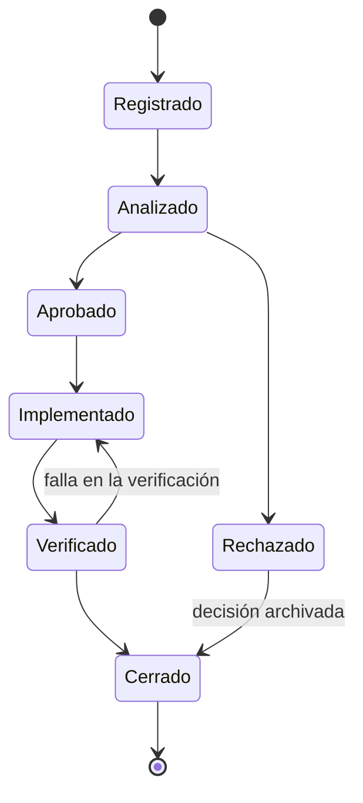

# G02 | Gestión y seguimiento de requisitos

**Responsable de la guía** · Ower López Arela.\
**Curso** · Calidad de Software · 2026-B · Escuela Profesional de Ingeniería de Sistemas, UNSA.\
**Proyecto** · AgroRetorno · Equipo de ingeniería.

[Informe G02 en PDF](Informe_G02_AgroRetorno.pdf).

## Objetivo y procedimiento

Registrar requisitos y decisiones de cambio con referencias a su diseño, implementación y verificación. Se configuró un gestor local con **SQLite 3.53.1** mediante Python, un catálogo ERS en Markdown y un historial versionado con **Apache Subversion 1.14.5**. El esquema del gestor es la versión 1, con identificador único, referencia del evento al requisito y catálogo de estados. El CSV usa UTF-8, coma y fechas ISO 8601 en UTC y se puede importar a Excel.

| Campo del historial | Uso |
|---|---|
| `fecha_utc`, `responsable` | Identifican la ejecución documentada. |
| `id`, `estado` | Vinculan el ID de la ERS con el estado registrado. |
| `referencia`, `evidencia` | Fijan revisión o caso y dónde inspeccionar el resultado. |
| `aceptacion_funcional` | Registra si existe decisión de un representante de negocio. |

La ERS de G01 es el catálogo de alcance. [ERS versionada](https://github.com/MauricioZegarra/AgroRetorno/blob/feature/ower-g01-requerimientos/entregables/G01_Requerimientos/ERS.md). El gestor reconstruye la vista operativa de los cinco requisitos seleccionados. [Configuración y eventos SQL](gestor.sql) · [Exportación CSV](historial_requisitos.csv) · [Matriz de trazabilidad](trazabilidad/Matriz_Trazabilidad.md) · [Solicitudes y diseño](Cambios.md) · [Acta de CR-01](Acta_Cierre_CR01.md) · [Índice de G01, G02 y G05](trazabilidad/README.md).

Para verificar el esquema y generar la misma exportación desde este directorio:

```bash
python3 - <<'PY'
import csv
import sqlite3
import sys
from pathlib import Path

with sqlite3.connect(':memory:') as gestor:
    gestor.execute('PRAGMA foreign_keys = ON')
    gestor.executescript(Path('gestor.sql').read_text(encoding='utf-8'))
    assert not gestor.execute('PRAGMA foreign_key_check').fetchall()
    eventos = gestor.execute('''SELECT fecha_utc, id, estado, responsable, referencia,
                                      evidencia, aceptacion_funcional
                               FROM eventos ORDER BY secuencia''')
    salida = csv.writer(sys.stdout, lineterminator='\n')
    salida.writerow([columna[0] for columna in eventos.description])
    salida.writerows(eventos)
PY
```

## Flujo de trabajo



| Transición | Responsable | Evidencia mínima |
|---|---|---|
| Registrar y analizar | Analista | Fuente, prioridad, impacto y criterio de aceptación. |
| Aprobar o rechazar | Responsable facultado | Decisión, fecha, revisión y fundamento. Registrar un diferimiento cuando la decisión se pospone. |
| Implementar | Desarrollador | Revisión, diseño, código y casos afectados. |
| Verificar | Evaluación de calidad | Entorno, prueba repetida, resultado y revisión. |
| Cerrar | Responsable del cambio | Resultado aceptado, referencias y decisión de cierre. |

Para los requisitos preexistentes, el historial registra **la observación de la implementación del primer avance** y la verificación técnica de casos concretos. La aceptación de negocio de los cinco requisitos queda pendiente de registro.

## Informe de seguimiento

| Requisito | Cobertura revisada | Evidencia |
|---|---|---|
| RF01 | Autenticación y cierre | SEG-02. |
| RF02 | Restricción de rutas por rol | SEG-04 y SEG-05. |
| RF05 | Ajustes e invariantes de inventario | PU-11 a PU-15. |
| RF07 | Registro válido, límites y rechazo de entradas inválidas | PU-16 a PU-21, SEG-07 y SEG-10. |
| RF13 | Devoluciones por condición, parciales y totales, con cierre | PU-34 a PU-42 e IT-01. |

La hoja contiene eventos de registro, análisis, observación de la implementación y verificación técnica. Para los estados de aprobación y cierre se requiere la decisión documentada del responsable.

## Comparación de herramientas

| Criterio | SQLite/Markdown con SVN, utilizado | Scarab, alternativa G02 |
|---|---|---|
| Campos | Claves y estados definidos en el esquema. | Seguimiento de incidencias con atributos y categorías configurables. |
| Historial | Eventos exportables en CSV y revisiones auditables con SVN. | Gestión mediante aplicación web y reportes. |
| Flujo | Registro local por procedimiento, reglas de datos y revisión. | Configuración en una aplicación compartida y gestión de usuarios. |
| Adecuación | Suficiente para el volumen de este bloque y para una exportación portable. | Atractivo para más revisores y cambios simultáneos. Requiere instalar y mantener el servicio. |

## Verificación de laboratorio

[Pruebas sobre PostgreSQL](verificacion/README.md).

## Análisis y conclusiones

El gestor registra 20 eventos para cinco requisitos. Se verificó la integridad referencial y se exportó el historial. El flujo técnico de CR-01 se puede recorrer desde la línea base hasta la regresión post-merge. G02 pide cotejar con el Anexo 21, cuya copia no estaba incluida en los nueve PDF de Drive. Su contraste queda pendiente. [Guía G02](https://drive.google.com/file/d/1rXwSinJXhPNrMSo7P-bsIcpsQEb6Qg3l/view).

## Cuestionario

- **Actividades esenciales.** Identificar, definir criterios, decidir cambios, registrar trazabilidad, verificar y cerrar con evidencia. La frecuencia depende del volumen de cambios.
- **Herramienta según contexto.** Un registro local versionado es suficiente para cinco requisitos. Un gestor web facilita permisos, colaboración y seguimiento cuando intervienen varias áreas.
- **Recursos.** Proponer inicialmente 10 % de la capacidad como reserva de planificación. Ajustarla al volumen, impacto, pruebas y costo de los cambios. La proporción es un supuesto, no una medición del proyecto.
