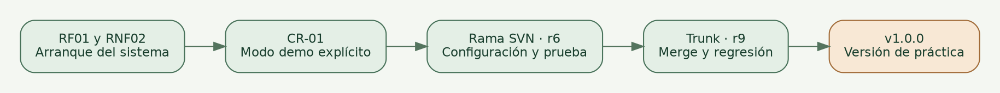

# AgroRetorno | Entrega de Ower

G01 documenta la línea base del primer avance con **15 requisitos funcionales y 10 no funcionales**. G02 sigue los requisitos y las solicitudes. G05 documenta la integración SVN y la restauración. Los enlaces abren los entregables en la rama Git de cada guía.

| Entregable | Contenido |
|---|---|
| [G01 · Especificación](https://github.com/MauricioZegarra/AgroRetorno/blob/feature/ower-g01-requerimientos/entregables/G01_Requerimientos/ERS.md) | ERS versionada, requisitos, criterios, fuentes e interfaces. |
| [G01 · Elicitación](https://github.com/MauricioZegarra/AgroRetorno/blob/feature/ower-g01-requerimientos/entregables/G01_Requerimientos/Elicitacion.md) y [plan](https://github.com/MauricioZegarra/AgroRetorno/blob/feature/ower-g01-requerimientos/entregables/G01_Requerimientos/Plan_y_Revision.md) | Entrevista, cuestionario, responsables, cronograma y revisión. |
| [G01 · Informe de la práctica](https://github.com/MauricioZegarra/AgroRetorno/blob/feature/ower-g01-requerimientos/entregables/G01_Requerimientos/README.md) | Procedimiento, resultados, conclusiones y cuestionario de la guía. |
| [G02 · Proceso](../README.md) | Seguimiento de cinco requisitos y exportación CSV. |
| [G02 · Cambios](../Cambios.md) | CR-01, CR-02, impacto, diseño y verificación. |
| [G05 · Configuración](https://github.com/MauricioZegarra/AgroRetorno/blob/feature/ower-g05-gestion-de-configuracion/entregables/G05_Gestion_Configuracion/README.md) | Historial, conflicto, etiqueta, recuperación y respaldo SVN portable. |
| [Trazabilidad](Matriz_Trazabilidad.md) | Del requisito al diseño, código, casos, cambio y evidencia. |
| [Revisión del primer avance](Revision_Primer_Avance.md) | Hallazgos para el grupo y para preparar la sustentación. |
| [Cobertura de la asignación](Cobertura_Asignacion.md) | Estado y evidencia de los 25 pasos. |

## Orden de sustentación

1. Presentar la línea base del primer avance y recorrer una fila de la ERS.
2. Explicar con un ejemplo la diferencia entre aprobar y entregar una solicitud.
3. Abrir CR-01 y mostrar la prueba que detecta el comportamiento anterior y pasa con el cambio.
4. Mostrar el conflicto de documentación, su resolución y la revisión integrada.
5. Mostrar la etiqueta y recuperar el repositorio a partir del dump.
6. Indicar el estado de elicitación, aprobación, ejecución personal y TortoiseSVN con las evidencias que existan al día de la exposición.

## Actividades que requieren evidencia adicional

| Actividad | Evidencia para completarla |
|---|---|
| Participación de usuarios representados | Fecha, roles y respuestas a entrevista y cuestionario. Validación posterior de las decisiones. |
| Autoría personal y aprobación académica | Ejecución y evidencia propias de Ower, revisión nominal y cierre firmado o registrado. |
| Cliente gráfico TortoiseSVN | Instalación y versión en Windows, más una operación sobre el repositorio de práctica. |
| Resultados de G08 y G09 | Reportes vinculados al escenario, revisión y entorno. Estas guías pertenecen a otros responsables. |
