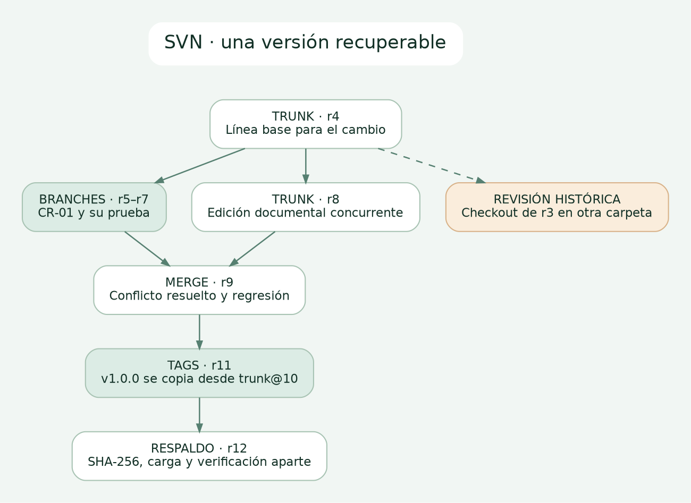

# G05 | Informe de práctica de configuración

**Responsable de la guía** · Ower López Arela.\
**Curso** · Calidad de Software · 2026-B · Escuela Profesional de Ingeniería de Sistemas, UNSA.\
**Proyecto** · AgroRetorno · Equipo de ingeniería.

[Informe G05 en PDF](Informe_G05_AgroRetorno.pdf).

## Objetivo

Demostrar que la línea base de AgroRetorno, un cambio controlado y su resultado se pueden identificar, reconstruir y restaurar mediante Subversion. [Guía G05](https://drive.google.com/file/d/1pnAS96WmcBGbDNEc6ol0eNS3Ate5x9kg/view).



## Procedimiento y resultados

Repositorios FSFS locales. Cliente y administrador SVN 1.14.5, Debian 13. El repositorio de práctica se creó para esta entrega. Sus revisiones son propias de esta ejecución. [Política](Politica.md) · [Versiones comprobadas](evidencias/herramientas.txt).

| Revisión | Operación |
|---|---|
| r1 | Estructura SVN e importación del árbol completo de `main` en Git `a28b7e46875d362b5074cff7149343457a4e01a6`. |
| r2 | Descriptor y Wrapper Maven de la rama G07 en `9a02df1bd94b1ea3197cac87836bd2d05c8b602b`. |
| r3 | ERS cotejada con el primer avance, instrumentos y plan de revisión. |
| r4 | Solicitudes, flujo del gestor y política de configuración. |
| r5 | Creación de la rama `CR-01-demo-opt-in` desde `trunk/AgroRetorno@4`. |
| r6 | Cambio de arranque, ajuste de ERS y nueva prueba. |
| r7 | Procedimiento explícito del modo de demostración en la rama. |
| r8 | Nota de aislamiento de la base de laboratorio en trunk. |
| r9 | Merge de CR-01, resolución de conflicto y repetición de pruebas sobre el resultado. |
| r10 | Seguimiento, informes de guía, trazabilidad y documentación de entrega. |
| r11 | Copia de `trunk/AgroRetorno@10` a `tags/v1.0.0`. |
| r12 | Corrección del orden de importación del gestor SQLite y actualización del informe. |

[Historial SVN detallado](evidencias/svn-log.txt) · [Checkout](evidencias/svn-checkout.txt) · [Update](evidencias/svn-update.txt) · [Diff del cambio](evidencias/cr01-diff-svn.txt).

### Conflicto controlado

Se editó deliberadamente la misma línea de una nota de práctica en la rama y en trunk. Una edición describía la habilitación explícita y la otra el aislamiento de la base. Se revisaron las tres variantes, se conservaron ambas condiciones y se marcó resuelto antes de confirmar r9.

[Base](evidencias/conflicto/01-base-r4.md) · [Trunk](evidencias/conflicto/02-trunk-antes.md) · [Rama](evidencias/conflicto/03-rama-antes.md) · [Merge](evidencias/conflicto/04-salida-merge.txt) · [Estado](evidencias/conflicto/05-status-conflicto.txt) · [Marcadores](evidencias/conflicto/06-conflicto-con-marcadores.txt) · [Resolución](evidencias/conflicto/07-resolucion.txt) · [Resultado](evidencias/conflicto/08-despues.md) · [Commit](evidencias/conflicto/09-commit.txt).

### Regresión de CR-01

| Ejecución | Resultado |
|---|---|
| Suite base SVN r2 | 72 pruebas aprobadas. |
| Nueva prueba sobre el código r2 | 4 ejecutadas, con 2 fallas esperadas por la carga activada ante configuración ausente. |
| Nueva prueba en la rama SVN r6 | 4 aprobadas. |
| Suite integrada en trunk SVN r9 | 76 aprobadas, con cero fallos, errores y omisiones. JaCoCo: 496 de 508 líneas de servicios, 97,64 %. |

[Ejecuciones y fecha de prueba](evidencias/maven-resumen.txt) · [Resultado por caso](evidencias/maven-casos.csv).

La regresión corresponde a Maven/JUnit, con H2 para integración. La aceptación del representante, la prueba web de G09 y la ejecución personal de Ower requieren sus propios registros. El código de r9 se conservó en la etiqueta.

### Etiqueta y recuperación

La etiqueta SVN `v1.0.0` se creó en **r11** a partir de la revisión **r10** de `trunk/AgroRetorno`. El contenido evaluado de `src/`, `pom.xml` y los Wrappers se cotejó por bytes con los archivos compilables de G02. [Commit Git de CR-01](https://github.com/MauricioZegarra/AgroRetorno/commit/383505a9b4e577a1575aaaa2cb495b5ff7a7767c). El dump conserva la instantánea de la práctica SVN. La recuperación histórica se hizo con un checkout de r3 en otra carpeta, preservando el trunk vigente. [Etiqueta, equivalencia y recuperación](evidencias/svn-etiqueta-recuperacion.txt).

### Respaldo portable

[Descargar dump comprimido](respaldo/agroretorno-svn-r12.dump.gz) · [SHA-256](respaldo/SHA256SUMS) · [Verificación y restauración ejecutadas](evidencias/svn-restauracion.txt).

Con Subversion 1.14 o posterior, ejecutar el [restaurador](respaldo/restaurar.sh) desde la carpeta `respaldo` en Bash. El script verifica SHA-256, crea un repositorio en una ruta nueva, carga el dump, verifica r12 e inspecciona la etiqueta.

```bash
bash restaurar.sh agroretorno-restaurado
svn checkout "file://$PWD/agroretorno-restaurado/tags/v1.0.0" version-v1.0.0
```

Se comprobó la restauración en Linux y el rechazo de destinos que ya existen y dumps con SHA-256 distinto. En Windows, usar Git Bash con SVN en el PATH o descomprimir como binario y pasar el dump a `svnadmin load` desde CMD. [Procedimiento y evidencia requerida de TortoiseSVN](TortoiseSVN.md).

Para recorrer el cambio desde el requisito hasta esta evidencia, consultar [la matriz de G02](https://github.com/MauricioZegarra/AgroRetorno/blob/feature/ower-g02-proceso-de-requerimientos/entregables/G02_Proceso_Requerimientos/trazabilidad/Matriz_Trazabilidad.md#trazabilidad-de-cr-01).

## Análisis y conclusiones

SVN conserva la revisión original, el origen de la rama y de la etiqueta y la documentación del merge. El dump se cargó en otro repositorio y se compararon historia y contenido. La demostración acredita la práctica con la CLI. La guía solicita también TortoiseSVN en Windows y ejercicios de un manual adjunto. El registro de esos pasos queda pendiente.

## Cuestionario

- Se puede recuperar cualquier revisión disponible en el historial o en un dump que la contenga. Un checkout histórico a una carpeta separada permite consultar esa versión preservando trunk.
- La etiqueta adoptada es `vMAJOR.MINOR.PATCH`. La primera instantánea evaluable se llama `v1.0.0`.
- El flujo de actualización muestra selección de revisión, rama, cambio, merge, verificación y etiqueta. [Diagrama de CR-01](https://github.com/MauricioZegarra/AgroRetorno/blob/feature/ower-g02-proceso-de-requerimientos/entregables/G02_Proceso_Requerimientos/trazabilidad/visuales/trazabilidad-cr01.png).
